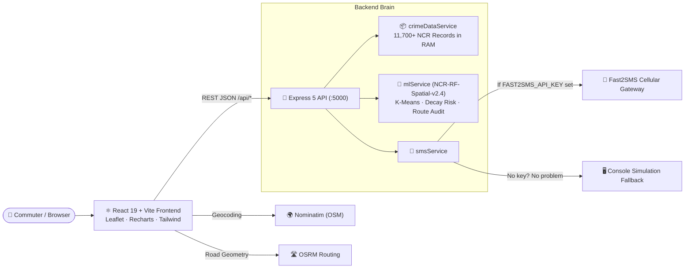

<div align="center">

# 🛡️ SafetyWatch
### *Because "shortest route" shouldn't mean "shortest path to losing your phone."*

**An AI-powered NCR Crime Map, ML Risk Predictor, Safe Route Navigator & Emergency SOS System.**

[](https://react.dev/)
[](https://vite.dev/)
[](https://tailwindcss.com/)
[](https://expressjs.com/)
[](https://leafletjs.com/)
[](https://github.com/mauryarimjhim/SafetyWatch)

<p>
  <a href="#-the-glow-up-features">Features</a> •
  <a href="#-how-the-magic-happens-architecture">Architecture</a> •
  <a href="#-zero-to-hero-quickstart">Quickstart</a> •
  <a href="#-the-ml-brain-no-gpu-harmed">ML Engine</a> •
  <a href="#-api-menu">API Reference</a> •
  <a href="#-project-anatomy">Project Structure</a>
</p>

</div>

---

## 🎭 What Even Is SafetyWatch?

Normal map apps ask: *"How fast do you want to get there?"*
**SafetyWatch asks:** *"How attached are you to your wallet, your peace of mind, and making it home before your mom calls 14 times?"*

Built specifically for **Delhi-NCR** (**Delhi, Noida, Gurugram, Ghaziabad, Faridabad, and Greater Noida**), SafetyWatch pairs an in-memory dataset of **11,700+ NCR crime records** with custom JavaScript Machine Learning, real-time road routing, browser GPS sentinel alerts, and optional **Fast2SMS** cellular emergency texting.

> [!TIP]
> **Best part?** Zero credit cards. Zero paid map API keys. Everything runs on open-source **Leaflet + CARTO Dark**, **OSRM**, **OpenStreetMap Nominatim**, and pure, caffeinated JavaScript.

---

## ✨ The Glow-Up (Features)

### 🗺️ 1. Dark-Mode Crime Map (Vibes & Vigilance)
* **CARTO Dark Matter Tiles + Leaflet:** Looks like a secret agent dashboard while you're just checking if Connaught Place is chill at 11 PM.
* **Heatmaps & Severity Markers:** Toggle the green-to-red crime density heatmap or inspect individual pins across **10 crime categories** (`Theft`, `Assault`, `Robbery`, `Burglary`, `Vandalism`, `Harassment`, `Fraud`, `Murder`, `Cyber Crime`, `Vehicle Theft`).
* **Slice & Dice Filters:** Filter by NCR city, crime type, severity slider (`1–5`), and date range—or submit a live incident report right onto the feed.

### 🚗 2. Fastest vs. Safest Route Navigation
* **Two Paths Diverged in NCR:** Toggle between **Fastest Route** (blue) and **Safest Route** (green), powered by **OSRM** real-road geometry.
* **Waypoint Interrogation:** Every route gets audited by our backend ML route evaluator (`/api/ml/route-risk`), highlighting sketchy waypoints and handing you a **0–100 Safety Score** before you even put your shoes on.

### 🧠 3. ML-Powered NCR Analytics & Danger Forecasts
* **City Danger Prediction Widget:** Dedicated locality-level risk breakdown across all **6 NCR hubs**, complete with peak danger windows, predicted crime surge percentages, and patrol priorities.
* **Interactive ML Risk Predictor:** Pick any NCR city and hour of the day (`00:00–23:00`) to compute an instant risk index (`0–98`), crime-type probability breakdown, and street-smart safety advice.
* **Recharts Eye Candy:** Pie charts (crime mix), line charts (monthly trends + 6-month forecast), area charts (hourly risk curves), and bar charts (top hotspot areas) plus `/api/analytics/ncr-summary` city-vs-city showdowns.

### 🛡️ 4. UnsafeZoneSentinel (Your Digital Bodyguard)
* Turn on **Sentinel Mode** and it watches your live browser GPS (`navigator.geolocation.watchPosition`).
* If you wander into a zone with an ML predicted risk index **≥ 68**, it fires a desktop/browser alert, pops an in-app warning modal, and can dispatch a cellular SMS (with a polite **3-minute cooldown** so your phone doesn't vibrate into orbit).

### 🚨 5. Panic-Proof Emergency Suite & Fast2SMS
* **Floating Pulsing SOS Button:** Available everywhere—one tap broadcasts GPS coordinates, uses the Web Share API, and triggers emergency alerts.
* **Haversine Police Station Finder:** Automatically sorts nearby Delhi-NCR police stations by exact spherical distance (`km`) with tap-ready phone numbers.
* **8 Tap-to-Call Helplines + SMS Inbox:** Quick-dial emergency cards, profile registration (`AuthModal`) with a **"Send Trial SMS"** button, and an `SMSInboxModal` log viewer.

---

## 🏗️ How the Magic Happens (Architecture)

No 47-microservice Kubernetes headache. Just a clean React + Express split talking to open geo services and an optional SMS gateway:



---

## ⚡ Zero-to-Hero Quickstart

### Prerequisites
* **Node.js `v18+`** (Recommended `v20+` so `process.loadEnvFile()` works natively without extra `dotenv` baggage!)
* **npm**
* At least one functioning finger to run `npm install`

### 1. Clone & Install

```bash
git clone https://github.com/mauryarimjhim/SafetyWatch.git
cd SafetyWatch
```

### 2. Fire Up the Backend (Terminal 1)

```bash
cd backend
npm install
npm start
# 🚀 SafetyWatch NCR Crime Analytics & ML API running on port 5000
```

> Want live auto-reload while hacking on the API? Run `npm run dev` (`node --watch server.js`).

### 3. Fire Up the Frontend (Terminal 2)

```bash
cd frontend
npm install
npm run dev
# ⚡ Vite dev server running at http://localhost:5173
```

### 4. (Optional) Enable Real Cellular SMS Alerts via Fast2SMS

By default, SafetyWatch runs smoothly in **Console Simulation Mode** for SMS—meaning it logs every alert cleanly to your backend terminal without needing a paid account.

Want real texts hitting real phones in India? Create `backend/.env`:

```env
PORT=5000
FAST2SMS_API_KEY=your_actual_fast2sms_api_key_here
# Optional DLT Sender ID:
# FAST2SMS_SENDER_ID=FSTSMS
```

Check `GET http://localhost:5000/api/health` — if `fast2sms_key_configured` says `true`, your cellular gateway is live!

---

## 🧠 The ML Brain (No GPUs Were Harmed)

While everyone else is burning rainforests to run giant LLMs for `2 + 2`, SafetyWatch's `backend/services/mlService.js` runs lean, deterministic spatial-temporal math directly in Node.js:

<details>
<summary><b>🔍 Peek under the hood of <code>NCR-RF-Spatial-v2.4</code> & K-Means</b></summary>

1. **K-Means Spatial Clustering (`runKMeansClustering`):**
   Groups historical NCR incidents into `k` spatial danger hotspots (default `k = 6`, up to `100` iterations), computing each cluster's center `(lat, lng)`, `avg_risk`, `top_crime`, `peak_hour`, dynamic radius (`800m–2500m`), and severity color.
2. **Exponential Distance-Decay Risk Predictor (`predictCrimeRisk`):**
   - Scans historical incidents within a **3 km Haversine radius** of the target coordinates.
   - Weights closer crimes exponentially higher using `w = e^(-dist)`.
   - Applies a **temporal risk multiplier** because 2 AM and 2 PM are very different universes:
     - `22:00 – 04:00`: **`1.35×`** (Night Owl Multiplier)
     - `18:00 – 21:59`: **`1.15×`** (Evening Rush)
     - `09:00 – 17:59`: **`0.85×`** (Daylight Chill)
   - Outputs `predicted_risk_index` (`15–98`), crime-type probabilities, and tailored safety advice.
3. **Route Safety Evaluator (`evaluateRouteSafety`):**
   Scores every waypoint along a candidate OSRM path, flags segments where `predicted_risk_index > 65`, and computes an overall `0–100` route safety score (`VERY SAFE`, `MODERATE`, or `HAZARDOUS`).

</details>

---

## 📡 API Menu

Base URL: `http://localhost:5000/api`

| Group | Method | Endpoint | What It Does |
| :--- | :---: | :--- | :--- |
| **Health** | `GET` | `/health` | Confirms API status, NCR coverage & Fast2SMS key status |
| **Crimes** | `GET` | `/crimes?city=Delhi&type=Theft&severity=3&limit=500` | Returns normalized, filtered NCR crime records |
| **Crimes** | `GET` | `/crimes/heatmap?city=Delhi` | Returns `[lat, lng, intensity]` tuples for `leaflet.heat` |
| **Crimes** | `POST` | `/crimes/report` | Submits a new incident report (`type`, `lat`, `lng` required) |
| **Analytics** | `GET` | `/analytics?city=Delhi` | Pie, monthly line, area bar, hourly risk, predictions & danger zones |
| **Analytics** | `GET` | `/analytics/ncr-summary` | Compares stats across all 6 NCR cities |
| **ML Engine** | `GET` | `/ml/clusters?city=Delhi&k=6` | Runs K-Means clustering to return hotspot danger zones |
| **ML Engine** | `POST` | `/ml/predict` | Predicts risk index & probabilities for `{ lat, lng, city, hour }` |
| **ML Engine** | `POST` | `/ml/route-risk` | Evaluates safety score & risky segments for `{ waypoints }` |
| **Emergency** | `GET` | `/emergency/stations?lat=28.61&lng=77.20` | Lists police stations sorted by Haversine distance |
| **Emergency** | `POST` | `/emergency/sos` | Fires an SOS alert + PCR ETA + SMS notification |
| **Emergency** | `POST` | `/emergency/send-sms` | Dispatches a test, unsafe-zone, or SOS SMS |

---

## 🛠️ Tech Stack

| Layer | Weapons of Choice | Why We Chose Them |
| :--- | :--- | :--- |
| **Frontend** | React 19, Vite 8, Tailwind CSS 3, React Router 7 | Fast builds, dark glassmorphism, zero bloat |
| **Maps & Geo** | Leaflet, `react-leaflet`, `leaflet.heat`, `leaflet-routing-machine`, CARTO Dark | Gorgeous dark maps without begging Google for an API key |
| **Routing & Lookup** | OSRM + OpenStreetMap Nominatim | Free real-road routing & reverse geocoding |
| **Charts & Icons** | Recharts + Lucide React | Crisp telemetry charts & clean iconography |
| **Backend** | Node.js + Express 5 + CORS | Fast JSON API with native `.env` loading |
| **ML & Data** | Custom JS Spatial ML + `combined_ncr_dataset.json` | Instant in-memory queries across 11,700+ NCR records |
| **Alerts** | Browser Geolocation + Notification API + Fast2SMS | Real-time sentinel warnings & optional cellular SMS |

---

## 📁 Project Anatomy

```text
SafetyWatch/
├── frontend/                              # React 19 + Vite + Tailwind UI
│   ├── src/
│   │   ├── pages/                         # 4 core routes
│   │   │   ├── Home.jsx                   # Landing page, hero & feature showcase
│   │   │   ├── MapPage.jsx                # Live crime map, routes, Sentinel & filters
│   │   │   ├── AnalyticsPage.jsx          # NCR dashboards, ML predictor & danger widgets
│   │   │   └── EmergencyPage.jsx          # SOS, GPS tracker, police stations & helplines
│   │   ├── components/                    # 17 modular UI & safety widgets
│   │   │   ├── MapView.jsx                # Leaflet map, markers, heatmaps & route layers
│   │   │   ├── RouteControls.jsx / RouteDisplay.jsx
│   │   │   ├── UnsafeZoneSentinel.jsx     # Live GPS + Notification + SMS danger sentinel
│   │   │   ├── MLRiskPredictor.jsx        # Interactive city/hour ML risk simulator
│   │   │   ├── CityDangerPredictionWidget.jsx
│   │   │   ├── AuthModal.jsx / SMSInboxModal.jsx
│   │   │   ├── CrimeFilters.jsx / SafetyScore.jsx / SOSButton.jsx
│   │   │   └── Navbar.jsx / Hero.jsx / SearchBox.jsx / FeatureCards.jsx / Footer.jsx / AnalyticsLocationSearch.jsx
│   │   ├── services/                      # api.js, geocoding.js (Nominatim), routing.js (OSRM)
│   │   └── utils/                         # constants.js, crimeData.js, riskScoring.js, mlPredictor.js
│   └── package.json
│
├── backend/                               # Express 5 API + ML + SMS Engine
│   ├── data/
│   │   └── combined_ncr_dataset.json      # Unified 11,700+ record NCR dataset (~4.8 MB)
│   ├── routes/                            # analytics.js, crimes.js, emergency.js, ml.js
│   ├── controllers/                       # analyticsController.js, crimeController.js, emergencyController.js
│   ├── services/                          # crimeDataService.js, mlService.js, smsService.js
│   ├── server.js                          # Express app + /api/health
│   └── package.json
│
└── dataset/                               # Data wrangling & clustering scripts
    ├── combine-and-seed-ncr.js            # Merges & enriches multi-source NCR crime datasets
    ├── kmeans-v2.js / fix-coordinates.js  # Spatial coordinate cleanup & clustering helpers
    ├── delhi-police-stations.js / real-zones.js / danger-zones.json
    └── crime_dataset*.{json,csv}          # Raw NCR crime source datasets
```

---

## ❓ Frequently Anticipated Questions

<details>
<summary><b>"Wait, does this predict the future like Minority Report?"</b></summary>
Not quite—we don't have three telepaths floating in a pool. It analyzes historical spatial density, time-of-day risk curves, and severity weights to tell you which blocks deserve extra alertness. Still way better than guessing!
</details>

<details>
<summary><b>"My SOS button didn't text my phone—is it broken?"</b></summary>
Unless you added a valid <code>FAST2SMS_API_KEY</code> inside <code>backend/.env</code>, SafetyWatch intentionally runs in <b>Console Simulation Mode</b> so you can test everything for free. Pop open your backend terminal to see the formatted SMS payload!
</details>

<details>
<summary><b>"Why NCR specifically?"</b></summary>
Because navigating Delhi, Noida, Gurugram, Ghaziabad, Faridabad, and Greater Noida is already an extreme sport—might as well have telemetry.
</details>

---

## 📄 License

**MIT License** — fork it, remix it, add your own city's dataset, and build safer commutes.

<div align="center">
  <br />
  <sub>Made with ❤️, JavaScript, and mild paranoia about late-night NCR shortcuts.</sub>
</div>
